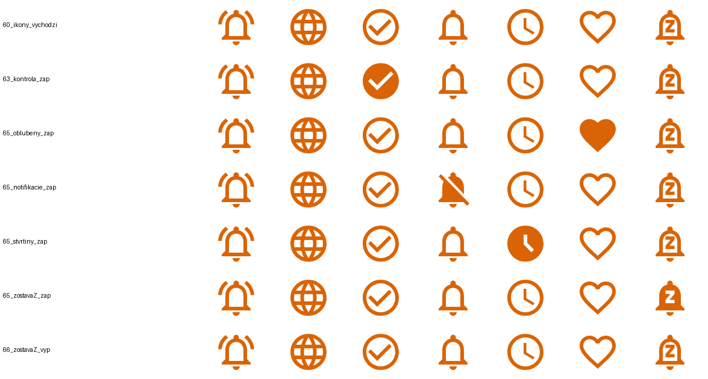

# BBALL – podrobné ovládanie mobilnej appky 1.0.50.0 a administrácie (8. 11. 2026)

[← späť na hlavný manuál](https://wczvonce.github.io/basketbalova-aplikacia-manual/)

Verzia manuálu: **8. 11. 2026**. Appka **BBALL** `sk.sotec.bball` **1.0.50.0** (vývoj SOTEC s.r.o., Peter Škantár).

Zdroje:
1. vlastné prechádzanie appky v 3. emulátore (BBALL3_API_36, `emulator-5588`), účet ivan.povraznik@gmail.com,
2. rozbor inštalačného balíka 1.0.50.0 (menu, obrazovky, texty),
3. tvoj GitHub manuál [basketbalova-aplikacia-manual](https://wczvonce.github.io/basketbalova-aplikacia-manual/) (stav 30. 10. 2026: audit kódu, APK 1.0.35.0, videá, správy vývojára). Odkazy „GH kap. N“ vedú na jeho kapitoly,
4. prevádzková webová administrácia `bball-admin.car-market.sk` a testovacia `bball-admin-test.car-market.sk`, obe iba na čítanie, nič sa neukladalo.

Značky: **✔** = vyskúšané v emulátore, **GH** = podľa GitHub manuálu, **❓** = neoverené, je medzi otázkami pre Ivana.
Čísla v zátvorke sú snímky obrazovky v Ivanovom lokálnom priečinku `json bball/manual/shots` (na GitHub sa nenahrávajú). Tento súbor je kópia lokálneho manuálu `MANUAL_BBALL.md` zo dňa 8. 11. 2026.

---

## 0. Prostredia, účty, adresy
| | Prevádzka (ostrá) | Test |
|---|---|---|
| API server | https://bball-api.car-market.sk | https://bball-api-test.car-market.sk |
| Webová administrácia (CMS) | https://bball-admin.car-market.sk | https://bball-admin-test.car-market.sk |
| **Účet (platí teraz, potvrdil Ivan 8. 11. 2026)** | **ivan.povraznik@gmail.com** | **wczvonce@gmail.com** |
| Účet do zmeny (GH, 17. 10. 2026) | wczvonce@gmail.com | ivan.povraznik@gmail.com |

- **Zmena prostredí:** pôvodná TEST verzia (s TOP2 hráčmi) prešla do prevádzky. Prevádzkový účet je odvtedy **ivan.povraznik@gmail.com** a testovací **wczvonce@gmail.com**, teda naopak ako predtým. Podľa čísel zápasov sa databázy rozdelili okolo 4. – 5. 11. 2026 (tabuľka nižšie).
- **Appka 1.0.50.0 v emulátoroch** je natvrdo nastavená na **prevádzkové API** (`bball-api.car-market.sk`). Iná adresa servera v balíku nie je. Prihlásený je **ivan.povraznik@gmail.com** (prevádzkový účet). V oboch administráciách existujú oba účty: „Ivan Povraznik“ (wczvonce, ID 6) aj „Ivan Povraznik 2“ (ivan.povraznik, ID 8). Prevádzka už má TOP2 hráčov.
- **Ktorá administrácia patrí appke (overené 8. 11. 15:10 podľa čísel zápasov):** testovacia `bball-admin-test` má **inú databázu** ako appka:

  | Zápas | Číslo v appke (JSON) | Číslo v `bball-admin-test` |
  |---|---|---|
  | Independiente – Racing de Chivilcoy, 4. 11. | 473107 | **473107** (rovnaké) |
  | Al-Riyadi – Chabeb Batroun, 5. 11. | 473658 | 473331 |
  | Falcon – Aabyhøj, 6. 11. | 473713 | 473636 (GS) / 473454 (FS) |
  | Batumi – TSU, 7. 11. | 474182 | 474057 (GS) / 473750 (FS) |
  | Barcelona – Breogan, 8. 11. | 474496 | 474283 (číslo 474496 je v teste iný zápas, NCAA Women) |

  Do 4. 11. boli obe databázy jedna (rovnaké čísla). Okolo 4. – 5. 11. sa rozdelili a odvtedy obe samostatne načítavajú zápasy z GS aj FS. Appka (aj Ivanov mobil) teda **nečíta** testovaciu databázu. Prevádzková je podľa údajov `bball-admin` + `bball-api` a testovacia je `bball-admin-test`.
  Priamo v `bball-admin` som čísla neoveril, lebo 8. 11. o 15:00 už chcela znova prihlásiť. Ivan však potvrdil, že prevádzka = ivan.povraznik (odpoveď na otázku 1).
- **Testovacia administrácia** (8. 11.): rovnakých 9 používateľov s rovnakými ID, rovnaké systémové nastavenia (WATCH 2 / 5 / 10 min / 7 b., OpenAI gpt-5-mini) a 305 422 zápasov s najnovšími na 9. – 10. 11. V zozname hráčov je vo filtri „Užívateľ“ iba **Povraznik 2 Ivan** (ivan.povraznik). Ten má označených hráčov Sledovaný / TOP / **TOP2** (napr. Tatum, Lillard, Mitchell).
- Od 17. 10. sa do každého prostredia dá prihlásiť iba jeho určeným účtom (GH kap. 1). Teraz to znamená: prevádzka = ivan.povraznik, test = wczvonce. Pri zmene prostredia na tom istom telefóne vývojár radí appku odinštalovať, prípadne vymazať jej dáta.
- Pri chybe servera („HTTP Error 503“) sa reštart žiada cez Webglobe Podpora/Helpdesk (GH kap. 26).

---

## 1. Prihlásenie ✔ (01)
Polia **Email** a **Heslo**, tlačidlá **PRIHLÁSIŤ** a **OBNOVIŤ HESLO** (príde email s postupom). Pri prvom spustení treba **povoliť notifikácie**.

## 2. Navigácia ✔
**Spodná lišta:**
- ♡ **Zaujímavé**: vyhodnotené zaujímavé (TOP) zápasy,
- ☰ **Všetky**: všetky zápasy, najnovšie hore,
- ⚙ **Nastavenia**.

**Bočné menu ☰** (vľavo hore na hlavných obrazovkách): email účtu, **Notifikácie**, Zaujímavé, Všetky, **Môj profil**, **Odhlásiť** (s potvrdením), Nastavenia, **Informácie o aplikácii**.
Systémové Späť na hlavnej obrazovke: „Chcete ukončiť aplikáciu?“

---

## 3. Zoznam zápasov ✔ (02, 05)
- **Lievik vpravo hore = Filter** (kap. 4). Android ho chybne opisuje ako „Načítať nanovo“.
- Potiahnutie zoznamu dole ho znova načíta. Ďalšie zápasy sa donačítavajú pri rolovaní.

### Gestá na zápase ⚠️
| Gesto | Čo urobí |
|---|---|
| ťuk | otvorí **Detail zápasu** (kap. 6). Dlhé podržanie robí to isté |
| **potiahnuť doľava** ✔ | otvorí **mobilnú administráciu súťaže** (kap. 9) |
| **potiahnuť doprava** (iba v Zaujímavých) | **odstráni zápas zo zoznamu a pošle serveru vylúčenie zápasu** (GH, APK K08). Nie je to iba skrytie. Ivan to nepoužíva a pre prácu to nie je podstatné. Neskúšal som to |

### Položka zápasu (zhora nadol)
**a) Rad 7 ikon** ✔ (vyskúšané 8. 11. na zápase Nevezis – Šiauliai, GS, snímka 67): každá platí pre tento zápas a tvoj účet. Ťuk zapne alebo vypne funkciu a zmenu uloží na server. Lokálna je iba pripomienka. Výnimka je ikona 2, ktorá iba otvorí web.
**Ako spoznáš zapnutú ikonu:** vypnutá je iba **obrys**, zapnutá je **vyplnená** (plná oranžová). Vysvetlenie ikon je aj v **legende na konci detailu zápasu** (kap. 6). Legenda sa ukáže iba pri zápase, ktorý už má zostavy.
| # | Ikona | Význam | Zapnutá vyzerá ✔ |
|---|---|---|---|
| 1 | 🔔 zvonček s vlnkami | **pripomienka začiatku zápasu**: lokálny budík v telefóne presne na čas začiatku. Na server nejde | plný zvonček s vlnkami. **Druhý ťuk ju nezruší** (8. 11. ostala zapnutá aj po 2 ďalších ťuknutiach, budík ostal nastavený). Zmizne až po zazvonení |
| 2 | 🌐 zemeguľa | **otvorí zápas na webe** (FlashScore alebo FIBA LiveStats) v prehliadači | nemá stav |
| 3 | ✔ v krúžku | **označiť na kontrolu** (filter „Kontrolované“) | plný krúžok s bielou fajkou |
| 4 | 🔔 zvonček | **notifikácie o zápase**. Ťuk zápas **vylúči z upozornení** | **prečiarknutý plný zvonček** = upozornenia na tento zápas vypnuté |
| 5 | 🕒 hodiny | **notifikácia na začiatku každej štvrtiny** (GS každá časť, FS iba 1. časť) | plné hodiny |
| 6 | ♡ srdce | **obľúbený zápas** (filter „Obľúbené“) | plné srdce |
| 7 | 🔔 so „Z“ | **notifikácia, keď existuje základná zostava** pred zápasom | plný zvonček so „Z“ |

Pri teste som každú ikonu zapol a hneď vypol (okrem pripomienky, tá sa vypnúť nedala). Stav na serveri ostal ako predtým.

**b) Súťaž**: `zdroj > liga > súťaž`. `FS` = FlashScore, `GS` = Genius Sports (FIBA LiveStats).

**c) Kurzy a dátum**: `1,67 / 1,84 ↑  07.11.2026 11:00  2,03 / 1,84 ↓`
- vľavo domáci, vpravo hostia. Dvojica čísel = **otvárací / posledný kurz** (Start/Last) na víťaza vrátane predĺženia,
- šípka ↑ zelená / ↓ červená = smer zmeny kurzu,
- kurzy sa čítajú z BetsAPI (Tipsport, inak priemer kancelárií) každých 10 min, od 90 min pred zápasom (GH kap. 9–10). Zápas bez kurzov má iba dátum.

**d) Tímy**: `Gimnasia (3)`. Číslo v zátvorke = **poradie v tabuľke súťaže**. Pri FS je z tabuľky FlashScore, pri GS iba pre tímy previazané na kurzy (GH kap. 19).

**e) Percentá pod tímami** `(38,52%)` = **index oslabenia**: chýbajúce PPG sledovaných hráčov ÷ priemer bodov tímu za posledných 10 zápasov (GH kap. 7–8). Zoznam ukazuje **posledné** vyhodnotenie, ktoré sa môže líšiť od stavu pri notifikácii.

**f) „> Časti zápasu“ + krúžky vpravo**: ťuk rozbalí štvrtiny. Ťuk na štvrtinu otvorí detail na tej štvrtine ✔.
- **Zelené krúžky = zostavy** (vysvetlil Ivan): **prázdne** = k zápasu ešte nie sú zostavy ani v appke, ani na webe. **Prvý plný** = nabehla **súpiska** (celková zostava). **Druhý plný** = nabehla aj **základná zostava** (kto začne na ihrisku). Zodpovedá to filtru „Celková zostava“ / „Základná zostava“ (kap. 4).
  - **Test 8. 11. 15:20 – 15:35** (skript `manual/skenuj_kruzky.py`, ~580 zápasov): každý zápas mal **oba prázdne alebo oba plné**, ani jeden nemal plný iba prvý. Filter „Celková zostava“ ukázal 81 zápasov, filter „Základná zostava“ 37 zápasov a všetky mali oba plné. Zápasy po 15:30 mali prázdne. GS zápas o 16:00 (Nevezis – Šiauliai) mal 25 min pred začiatkom v detaile „Nenašli sa žiadne údaje“. Súpiska a základná zostava teda zvyčajne nabehnú naraz, najčastejšie tesne pred začiatkom alebo pri ňom. Pri niektorých zápasoch nenabehnú vôbec (napr. 14:00 a 15:00 zápasy s prázdnymi krúžkami aj po začiatku).
  - Stav „iba prvý plný“ treba ešte zachytiť (sledovať zápas od ~30 min pred začiatkom).
- **Čierny krúžok** (vľavo od zelených, ✔ videný 8. 11. pri Salon Vilpas – Antwerp Giants) = **údaje zápasu sa zmenili**. Napr. v noci appka znova prejde zápasy, a keď sa na webe zmenili zostavy, zmenia sa aj v appke. Podľa GH (od TEST 1.0.40.0) sa tým zmení index oslabenia oproti hodnote v notifikácii (GH kap. 8).
- ⚠️ V **exporte JSON** sú polia `ExistLineupMark`, `ExistStarterMark` a `ChangeIndexTeamMark` vždy 0, aj keď appka ukazuje plné krúžky (overené na 11 JSON-och, napr. Batumi – TSU, Falcon – Aabyhøj).

---

## 4. Filter ✔ (06–12)
Funguje v **Zaujímavých** aj vo **Všetkých**. Iba triedi zobrazenie, na serveri nič nemení.
| Pole | Funkcia |
|---|---|
| Názov teamu | hľadá zápasy tímu |
| Dátum zápasu | kalendár (ZRUŠIŤ / OK). Ukáže **zápasy do zvoleného dňa smerom do minulosti** ✔. Krížik ✕ dátum vymaže |
| ☑ Genius Sports / ☑ Flashscore | zdroj. Iba jeden zapnutý = iba ten zdroj. Oba zapnuté **aj oba vypnuté** = bez obmedzenia (GH) |
| ☐ Celková zostava / ☐ Základná zostava | iba zápasy so známou súpiskou / základnou päťkou |
| ☐ Ukončené / ☐ Obľúbené / ☐ Kontrolované | podľa stavu a tvojich značiek |
| ☐ TOP zápasy | iba TOP zápasy, ten istý zoznam ako Zaujímavé ✔ |

**HĽADAŤ** filter použije, **✕** okno zavrie. Filter ostáva zapnutý, kým ho nezrušíš.

## 5. Notifikácie ✔ (04)
História upozornení **zo servera** (nie zo systémovej histórie telefónu). Ťuk na upozornenie otvorí zápas.
Druhy upozornení: nový zaujímavý / TOP zápas, začiatok zápasu, začiatok štvrtiny, existuje základná zostava, súpiska sledovaného tímu (tlačidlo A).
Keď je appka otvorená, upozornenie príde ako pruh s ✕ dole. Ťuk naň otvorí detail.
**Upozornenie na zaujímavý zápas sa posiela iba pred zápasom a v 1. štvrtine**, na jeden zápas iba raz (GH kap. 6).

---

## 6. Detail zápasu ✔ (14–21, 36)
### Horná lišta
| Prvok | Funkcia |
|---|---|
| ← | späť |
| `SZG : TRI` + čas | tímy a začiatok zápasu |
| ⧉ **Kopírovať do schránky** | **export JSON zápasu** do priečinka Download (`BBALL_<DOM>_<HOS>_<yyyyMMdd>.json`) a do schránky. Uloží to, čo je práve načítané v telefóne, preto **najprv daj ⟳**. Je to jeden zápas, nie pole (GH K05) |
| ⟳ **Načítať nanovo** | stiahne aktuálne dáta. Detail sa obnovuje aj sám každých X min (nastavenie „Interval obnovovania“) |

### Hlavička tímu
- `GS > M:474635 > T:133924` = zdroj, ID zápasu, ID tímu.
- **NOVÝ HRÁČ !!!** ✔: v súpiske je nový hráč (≤ 3 evidované zápasy, môže byť „adekvátna náhrada“). **Ťuk skopíruje údaje o všetkých nových hráčoch tímu do schránky** (hláška „Skopírované do schránky“). Formát (overené 8. 11., Studio Zagreb):
  `meno hraca: Tea Perok, team: Studio Zagreb, sutaz: GS > Waba - widget > 2026-27 WABA U17` a rovnaký riadok pre každého ďalšieho nového hráča.
  **Načo to je (Ivan):** oslabený tím môže mať na ihrisku nového hráča, napr. legionára, alebo slabého juniora či náhradníka. Text zo schránky vlož do Googlu a dohľadaj, či nový hráč nie je dobrý legionár, ktorý chýbajúceho nahradí.
- **TOP**: zápas vyhodnotený ako TOP (cez TOP2 hráčov). Podľa Ivana sa naň nedá ťuknúť, nič sa nestane.
- **💬 Poznámky** (25): okno s **Poznámkou súťaže** a **Poznámkou tímu**, ✏ na úpravu.
- **Názov tímu** otvorí obrazovku **Tím** (kap. 7).
- **A** = zapne alebo vypne **upozornenie na súpisku tohto tímu**. Server pošle notifikáciu pred zápasom, keď je evidovaných aspoň 6 hráčov (GH, APK K02). Nezaraďuje zápas medzi TOP.
- **R** (iba keď má súťaž „URL rebríčka“) otvorí **tabuľku súťaže** na webe.
- **Krúžky 1 – 9** otvárajú zápasy na zdrojovom webe. **1 = tento zápas** (pole `MatchUrl` v JSON-e), ďalšie = predchádzajúce zápasy tímu. Od 30. 10. sa zobrazujú iba zápasy od 1. 8. 2026 (GH kap. 27).
- Podľa balíka tu môže byť aj kurz a handicap tímu a tlačidlo **prepojeného zápasu** GS ↔ FS.

### Prepínanie tímov
Detail začína domácimi. **Potiahnutie doľava** zobrazí hostí, doprava domácich ✔.

### Záložky štvrtín `1 | 2 | 3 | 4`
Iba **GS**. Zostavy sa menia podľa štvrtiny: kto ju začal na ihrisku a kto bol na lavičke ✔.
**FS** ukladá iba súpisku pred zápasom a 1. časť. „Na ihrisku“ je tam odvodené zo základnej päťky, nie živý stav. Často „Nenašli sa žiadne údaje“ (GH kap. 3).

### Zoznam hráčov
Skupiny: **Chýbajúci hráči** (🚫 pred číslom = sledovaný hráč, ktorý nie je v súpiske), **Hráči na ihrisku**, **Hráči na lavičke**.

**Farba riadku hráča** (GH, APK K01):
| Farba | Význam |
|---|---|
| **ružová** | **TOP2** |
| **zelená** | **TOP** |
| **biela** | **WATCH** (alebo neúplné údaje) |
| **svetložltá (béžová)** | nesledovaný hráč |

**Krúžky bodov** (11, história od 1. 8. 2026):
- **sivý s číslom** = body, štatistiky existujú,
- **modrý** = neexistujú štatistiky,
- **čierny** = nekontrolované štatistiky,
- **ružový „?“** = hráč nehral, alebo pre zápas chýbajú bodové údaje (nemusí znamenať DNP),
- **prázdny** = zápas nie je.

**Štatistiky:**
| Skratka | Význam |
|---|---|
| 15Z / 5Z | v základnej päťke z posledných 15 / 5 zápasov (napr. 5/6) |
| MIN | priemerný čas |
| P | body celkom |
| PPG | body na zápas (zo zápasov od 1. 8. 2026; pri chýbajúcich webových štatistikách dopočítané) |
| PPG/M | body na minútu. **Zelené / červené** = nadpriemer / podpriemer (značka metriky, nie TOP) |
| RPG, RPG/M, AS/M | doskoky na zápas, doskoky na minútu, asistencie na minútu |

Ďalšie značky pri hráčovi: ↑/↓ trend, **PRIDANÝ** (hráč pridaný do súpisky neskôr), červený dátum = posledný zápas hráča, poznámka.
**Ťuk na meno hráča** ✔: pri zápase zo zdroja **FS** otvorí v prehliadači **stránku hráča na flashscore.sk** (overené 8. 11., Indiana Pacers – Jackson Q.). Pri **GS** zápase sa nestane nič.
**Profil hráča (AI)** (národnosť, vek, text z OpenAI) v balíku ešte je, ale **už nefunguje a Ivan ho nepoužíva**.

### Legenda na konci zoznamu ✔ (16)
Na konci detailu (zroluj úplne dole) je legenda: skratky, krúžky, 7 ikon a ikony previazania. **Ukáže sa iba pri zápase, ktorý už má zostavy.** Pri zápase bez údajov („Nenašli sa žiadne údaje“) legenda nie je.
- 🔗 reťaz: **zelená** = existuje previazanie GS ↔ FS, **červená** = neexistuje,
- 📈 krivka: **zelená** = previazanie s kurzami existuje, **červená** = neexistuje (nedokazuje, že kurzy sú načítané).

---

## 7. Tím ✔ (22–24)
**Posledné zápasy** tímu (od 1. 8. 2026): dátum, súťaž, skóre, pod ním indexy oslabenia.
**Červený riadok** = **PairMatch**: ako hral **dnešný súper** proti **tomu istému súperovi** (nie vzájomný zápas). Ťuk na riadok otvorí detail toho zápasu.

---

## 8. Nastavenia ✔ (28–30) a Legenda (31–32)
Ukladajú sa na server, platia pre účet aj v mobile. Ikona **?** vpravo hore = **Legenda** (vysvetlenie pravidiel).

### Sledovaní hráči (hodnoty 8. 11. 2026)
| Typ | Podmienky | Teraz |
|---|---|---|
| **TOP** | hral X z posledných Y **alebo** A z posledných B zápasov (počíta sa súpiska) + priemer minút ≥ M | X/Y 8/10, A/B 4/5, M 15 min |
| **TOP2** | to isté, ale počítajú sa **štarty v základnej päťke** + priemer bodov ≥ PPG | X/Y 4/5, A/B 8/10, PPG 5 |
| **WATCH** | X z Y + minúty + body | 2/5, 10 min, 7 PPG |

Ako to funguje (GH kap. 5):
- Do počtu sa rátajú iba ukončené zápasy od 1. 8. 2026, tím sa spája naprieč súťažami.
- Hráč bez štatistík z webu: prah minút a bodov sa preskočí, stačí počet zápasov. Dopočítané PPG sa na zaradenie nepoužíva.
- Keď tím nemá Y zápasov, pravidlo sa zníži (8/10 → 7/7).
- Priorita: TOP2 → TOP → WATCH.
- **WATCH je systémové nastavenie** (web: Systém → Nastavenia). Rovnaké hodnoty 2/5/10/7 sú tam aj v prevádzke.
- **TOP/TOP2: „alebo“ alebo „aj“?** Starší kód (september) hovorí, že stačí splniť X/Y **alebo** A/B. Vývojár 29. 10. napísal, že treba splniť X/Y **aj** A/B. **Pravidlo od Ivana: pri rozpore platí novší e-mail vývojára** → teraz platí **aj** (obe podmienky). Na konkrétnom hráčovi to zatiaľ nie je overené.
- **TOP2 = úplne najlepší hráči tímu, TOP = dobrí hráči** (Ivan). Čo presne znamená TOP2, nastavuje Ivan v Nastaveniach (tabuľka vyššie).
- **Dnešné hodnoty sú zámerné** (Ivan, 8. 11.): prísnejší WATCH (2/5, 10 min, 7 PPG), notifikácie aj z Flashscore, iba TOP zápasy a steam 100 %. Cieľ: pípajú iba úplne najlepšie zápasy a v appke sa neukazujú najslabší hráči, ktorí skoro nehrávajú.

### Všeobecné nastavenia
| Pole | Teraz | Význam |
|---|---|---|
| Adekvátna náhrada novým hráčom [%] (N) | 80 | nový hráč (≤ 3 zápasy) s PPG ≥ N % najlepšieho chýbajúceho → ten chýbajúci sa do oslabenia nepočíta |
| Percento rozdielu oslabenia tímov [%] (P) | 30 | zápas je zaujímavý, ak \|index domácich − index hostí\| ≥ P % |
| Pokles kurzu tímu [%] (S, steam) | 100 | ak kurz menej oslabeného tímu klesol od otvárania o ≥ S %, zápas sa vyradí. **100 = prakticky vypnuté** |
| Interval obnovovania detailu [min] | 1 | automatický ⟳ v otvorenom detaile |
| ☑ Kontrola hráčov v celej zostave pred zápasom | zap. | |
| ☑ Notifikácie zápasov z Flashscore | zap. | bez toho chodia iba GS |
| ☑ Notifikácie iba TOP zápasov | zap. | iba zápasy cez TOP2, bežné „zaujímavé“ nie |
| ☑ Prijímanie notifikácií | zap. | hlavný vypínač. Vypnúť a zapnúť znova = znovu registruje telefón |
| OpenAI model | gpt-5-mini | pre AI profil hráča |

Polia X/Y a A/B majú vlastné **ULOŽIŤ**. Po uložení znova otvor Nastavenia a over hodnoty (GH: staršia chyba potvrdenia uloženia).

### Ako vzniká zaujímavý zápas (GH kap. 2, 6, 7)
1. Pred zápasom: aspoň 6 hráčov v každom tíme a aspoň 5 zápasov v histórii. Pri základnej päťke ešte 5 štartujúcich.
2. Chýbajúci = sledovaný hráč, ktorý nie je v **celej súpiske** (lavička nie je chýbanie).
3. Najprv **TOP2**: index chýbajúcich TOP2, náhrada, rozdiel ≥ P, steam < S. Úspech = **TOP zápas**.
4. Ak TOP2 neprejde a „iba TOP“ je vypnuté, rovnako sa vyhodnotí **TOP**. Úspech = bežný zaujímavý zápas.
5. WATCH sa iba eviduje ako chýbajúci, signál nespúšťa.

---

## 9. Administrácia v appke ✔ (40–44)
**Potiahni zápas v zozname doľava** → **Administrácia** súťaže toho zápasu:
- názov súťaže a ligy (iba na čítanie),
- **Súťaž pre GS** (pri FS súťaži) alebo **Súťaž pre FS + Súťaž pre kurzy** (pri GS súťaži): výber zo zoznamu,
- **URL rebríčka** (zdroj tlačidla R),
- ☑ **Vyradené mapovanie**: FS súťaž, ku ktorej GS neexistuje (v kontrolnom maile potom zelené „GS: súťaž neexistuje“),
- ☑ **Platný**: súťaž sa načítava,
- **ULOŽIŤ**,
- **TÍMY** (vpravo hore) → **Zoznam tímov** súťaže. Pri každom tíme sú ikony `FS`/`GS`, 🔗 (GS↔FS) a 📈 (kurzy), červené alebo zelené.
  - Ťuk na tím otvorí **Administráciu tímu**: **Tím pre GS/FS** a **Tím pre kurzy**, **ULOŽIŤ**.

Postup mapovania: **súťaž → tímy → zápasy**. Pri GS↔FS sa prepojené zápasy ukážu hneď po ⟳. Kurzy sa načítajú až v najbližšom 10-minútovom cykle (GH kap. 10–11).
**Kto mapuje (Ivan, 8. 11.):** Ivan a Trnka, na webe aj v mobile. Ivan radšej v mobile, ale je to jedno. **Do budúcna to má robiť Claude za Ivana**, najprv ho však musí úplne pochopiť (samostatná úloha).

## 10. Webová administrácia (CMS) – prevádzka `bball-admin.car-market.sk`
Prihlásený je Marek Ludha. Overené 8. 11. iba čítaním.

Menu vľavo:
- **Štatistiky**
  - **Ligy**: zoznam líg (ID, GS/FS, názov, URL, stav, čas vzniku, Zobraziť), filter, **Nová liga**.
  - **Súťaže**: filter (text, poskytovateľ, liga, stav, ☐ previazané GS a FS, ☐ previazané s kurzami, ☐ existujú načítané údaje), export do Excelu. Riadok má ikony (zdroj, 🔗, 📈, údaje), ligu, názov, počet chýb, prepínač **Platný Áno/Nie** (ťuk ho hneď mení!), čas vzniku, **Tímy**, **Zobraziť**.
    - **Detail súťaže**: názov, URL súťaže, externé ID, liga, URL rebríčka, Súťaž pre FS/GS, Súťaž pre kurzy, Vyradené mapovanie, poznámka, chyby, stav, časy. Tlačidlá **Späť**, **Prebrať previazania** (nová sezóna, GH kap. 12) a **Uložiť**. Pri ručne zadaných GS súťažiach aj **Identifikovať súťaž** (GH kap. 13).
  - **Zápasy**: rovnaký filter a **Export zápasov** (JSON na analýzu, naplánuje sa na 4:00, GH kap. 23).
  - **Tímy**: filter, **Export tímov**, **Import tímov** (CSV: mapovanie GS/FS, kurzy, štát a pohlavie, interné ID, GH kap. 17–18).
  - **Hráči**: tím, meno, poznámka, stĺpce **Sledovaný / TOP / TOP2**, Zostava, **Export hráčov**.
  - **Zmena hráčov**: zoznam zmien hráča (ID, meno → „hráč PZ“). Tlačidlo Vymazať mení dáta.
- **Používatelia**: Používatelia (9 účtov vrátane oboch Ivanových), Role.
- **Systém → Nastavenia**: URL zdrojov GS, BetsAPI kľúč, **OpenAI model**, **WATCH X / Y / minúty / body** (2 / 5 / 10 / 7).

**Testovacia** `bball-admin-test.car-market.sk` (prešiel som ju 8. 11. iba čítaním, prihlásený Marek Ludha) má **rovnaké menu a obrazovky**: Ligy, Súťaže, Zápasy, Tímy, Hráči, Zmena hráčov, Používatelia, Role, Nastavenia. Má však **vlastnú databázu**, ktorá sa od prevádzkovej oddelila okolo 4. 11. (kap. 0).
- V zozname **Hráči** je filter **Užívateľ**. Vybraný používateľ určuje, čie značky Sledovaný / TOP / TOP2 sa v stĺpcoch ukážu. Ťuk na hlavičku stĺpca (napr. TOP2) zoradí zoznam, nič nemení.
- Pri úzkom okne skryje stĺpce Poznámka a Čas vzniku za „⋯“ na konci riadku.

---

## 11. Môj profil ✔ (33) a Informácie ✔ (34)
- **Môj profil**: email, meno, priezvisko, **ZMENIŤ HESLO**, **ODHLÁSIŤ**.
- **Informácie**: verzia, kontakt (Marek Ludha), vývoj SOTEC s.r.o., info@sotec.sk.

## 12. Čo som v emulátore zámerne nestláčal
A, TOP, potiahnutie doprava v Zaujímavých, úpravu poznámok, ULOŽIŤ v nastaveniach aj v administrácii, prepínače Platný/Vyradené a odkazy 1–9 a R. Všetko z toho mení dáta na serveri (alebo otvára prehliadač).
Ikony pri zápase, NOVÝ HRÁČ a meno hráča som 8. 11. vyskúšal na Ivanov pokyn. Ikony som vrátil do pôvodného stavu, okrem pripomienky (lokálny budík, kap. 3).

## 12a. Typický postup pri tipovaní (stručne od Ivana, 8. 11.) – podrobne doplniť
1. Príde notifikácia na zaujímavý zápas → ťuk otvorí detail.
2. Posúdi, či sa oplatí tipovať: **oslabenie tímov** (index %, chýbajúci hráči) a **kurzy** stávkových kancelárií.
3. Overí **náhradníkov** za chýbajúcich: nie sú to noví hráči alebo legionári, ktorí sú rovnako dobrí alebo lepší? Pomôže **NOVÝ HRÁČ !!!** (kopírovanie do schránky) a ťuk na meno pri FS.
4. Ak náhrada nie je kvalitná, odhadne šancu, že **kompletný (neoslabený) tím vyhrá**, a tipuje naň.

**Cieľ:** túto kontrolu má robiť Claude namiesto Ivana (skill). ❓ Ivan pošle presný postup krok za krokom, možno aj video. **Treba sa ho na to znova opýtať.**
